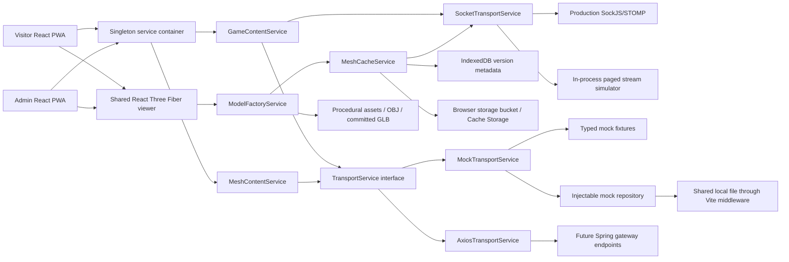

# Mesh District — architecture and implementation notes

## Scope and reference

Reference: `https://github.com/1pcreeper/1pcreeper`, snapshot `a03bc943a011114966e7429a9a32a0eb17cdcca7` (28 September 2026). The original checkout was inspected separately, then imported into this repository without replacing its `.git` history or `.gitattributes`. Original source files, Maven modules, existing SQL, root package scripts, office code, and deployment files are preserved. New work lives under `frontend/general/web`, `docs/content`, and `docs/prompt`.

The reference has a Java 17 Maven multi-module backend: general gateway, Eureka registry, config mapping, account service, OBJ generation service, dummy template, and shared starter/auth/common libraries. Gateway routing currently covers account and OBJ generation only. Game/mesh routing, public resource rules, and the two future services do not exist yet. Office code was used only for small frontend style samples and the requested Liquibase inheritance/enum reference; its business logic is outside this stage.

Observed conventions retained: four-space TypeScript formatting, DTO suffixes, `models/dto`, `services/content`, `components`, `pages`, constructor-injected service dependencies, named service classes, `getInstance()`, and `createBrowserRouter`. New singleton getters actually retain their `INSTANCE`; the reference office getter returns an unretained new instance. No reference implementation was modified. The shared Java response shape is exactly `{ success, message, data }`, including `data: null` on failure.

Updated 3 October 2026. The current streaming contract is [WEBSOCKET.md](WEBSOCKET.md); REST and DTO contracts are in [API.md](API.md).

## Added frontend workspace

```text
frontend/general/web/
  package.json                       # independent nested npm workspace
  package-lock.json                  # reproducible dependency versions
  user-mesh-shop-web/                 # Vite app, port 5173
  admin-mesh-shop-web/                # Vite app, port 5174
  mesh-shop-shared/
    src/models/dto/                   # API and domain DTOs
    src/mock/                        # typed world and catalog fixtures
    src/services/base/               # transport interface; Axios/mock implementations
    src/services/content/            # auth, game, mesh, model and workspace services
    src/services/storage/            # injectable mock repository and stores
    src/components/                  # reusable R3F viewer, dialogs, authentication UI
    src/contexts/                    # account state and staff route guard
    src/tests/                       # behavior tests
    dev/mockPlugin.ts                # loopback development fixture bridge
```

The independent workspace avoids changing the existing root workspace list or its office scripts. Install and run from this directory; see `README.md` there.



## Working behavior

- Home, `/shop` future-feature page, maps, merchant spots, interior places, product deep links, and optional account sign-in.
- Orbit/pan/zoom spectator camera; first-person WASD/arrow movement, pointer-lock look with mouse-drag fallback, Escape release, touch look and movement controls. Basic AABB collision with barriers and map buildings; Space-to-jump with gravity/landing, and no room-specific walking boundary. Camera mode persists through maps/spots/places, including teleport arrival coordinates. This is a local explorer, not a multiplayer or full physics engine.
- All maps, spots and places in both apps use 24-metre cells and a 5×5 neighbourhood. Repeated STOMP requests collect pages of at most 20 instance records for a pinned scene revision. Distant objects are hidden; visitor metadata history evicts older distant entries without truncating the current window. The fixtures represent a small district with geographic coordinates. The local projection uses +X east, +Z north, and +Y height, with latitude-adjusted metres per degree. Building coordinate edits and position gizmos stay synchronized. They are not a globe/terrain renderer; continental curvature and geospatial tiles remain future work.
- Hovering a product opens a small 3D preview with name, price and See More; full details occupy a full-screen dialog. Any placed mesh can have PRODUCT or TELEPORT behavior; reusable mesh geometry has none. Teleports specify destination type/ID, foot position and yaw. The accessible directory remains usable if WebGL fails.
- Paged staff overview, numeric mesh library/editor routes, merchant approval, creation of all three space types, and shared map/spot/place editor. Dataset dropdowns search and page at the service boundary; bounded local hierarchy/change lists also paginate.
- Independent OBJ objects; image texture library; pointer raycasting for texture drops; texture assignment by selector/click for touch and keyboard users; transform gizmos; numeric transforms; G/R/S; undo/redo; visibility; duplicate/delete; lights, grounds, barriers, door targets, buildings, and product assignments.
- OBJ imports are validated, centered, grounded, and normalized to a 2.5-metre maximum dimension. Missing UVs receive a simple planar projection. This is not a full UV-unwrapping or MTL workflow. Source OBJ content is retained.
- GLB export includes loaded, visible scene models, transforms, materials and supported lights; editor grids, camera helpers and transform gizmos are not exported. Mesh commit persists a GLB alongside paged editable source metadata and makes it reusable in other scenes. A scene export is explicitly labelled “Export visible GLB” because unloaded chunks are not part of its local render group.
- Scene drafts and published content are separate. Publishing advances the published version. Stale publication and draft generations are rejected. Delta saves send ordered batches of at most 20 operations and merge atomically, preserving unloaded objects. Raw geometry created in a space becomes a reusable mesh on save; small light/ground/barrier parameters remain scene data. New spaces stay private until published; connect them with a building/door in their parent scene.

## Mock persistence and boundaries

Development uses the two Vite servers as a shared fixture bridge at `/__mesh_mock/state`, storing one ignored JSON file in `frontend/general/web/.mesh-shop-runtime/world.json`. Both ports read that file, so admin publication becomes visible to visitors after a reload. Initial data comes from `src/mock/*.ts`. This is development middleware, not a new application backend. It does not start Java, Docker, PostgreSQL, MinIO, or Firebase.

The production build defaults to Axios plus SockJS/STOMP and never silently falls back to fixtures. `build:demo` explicitly enables a standalone demo, whose persistence is browser localStorage and origin-specific. Its two preview ports do **not** share storage. Use the development servers for a connected local user/admin workflow. Local fixture storage is not an authorization boundary: the development portal intentionally uses a labelled mock staff account.

Scene instances now pin numeric mesh IDs and immutable `versionId` values. A library commit creates a new version and keeps old binaries available; it cannot silently change previously published placements. Legacy local fixture slugs/portal fields migrate to numeric IDs and per-instance interactions without resetting the world.

## Authentication and authorization

Production uses Firebase Google or email authentication, then account verification at `/api/v1/account/auth/verify`. The bearer token is refreshed through the Firebase SDK when a request needs it. `_secure` is synchronized as requested, host-only, `SameSite=Lax`, and `Secure` on HTTPS. JavaScript cannot create an HttpOnly cookie; a later server session exchange is required for that property. No new session database is proposed; existing Spring Security session handling remains authoritative. See [MDN's cookie reference](https://developer.mozilla.org/en-US/docs/Web/HTTP/Reference/Headers/Set-Cookie).

Visitor reads do not require Firebase configuration or a token. The backend must allow the published map/spot/place metadata, paged chunk/catalog reads and exact published mesh fragment requests. Editable mesh source pages and draft chunks remain staff-only. Studio routes require verified ADMIN/STAFF and the reference GENERAL_ADMIN/GENERAL_STAFF roles (also accepting the `ROLE_` prefix). Server-side role enforcement is still required for every future mutation. The reference `Roles.GENERAL_ADMIN` value is supported directly. The gateway and Spring CSRF configuration are preserved; Axios uses credentials and `XSRF-TOKEN` / `X-XSRF-TOKEN`. Cross-origin CSRF bootstrap/CORS must be configured on the actual gateway.

## PWA and performance

Each app has its own manifest, icons, service worker and build output. Workbox precaches the application shell; API/auth/mock endpoints are excluded from navigation fallback, and authenticated API responses are not cached. Previously loaded app code and verified mesh binaries can be reused offline; entering a space still needs its current metadata/chunk responses, and publication requires a reachable service. This is not an offline world snapshot. The explicit standalone demo can edit its local state offline after the shell has been cached. Serve each app at the root of its own origin, with SPA route fallback to `index.html`; HTTPS is needed for deployed service workers.

Three.js assets dispose geometry, material and texture resources on replacement/unmount. Device pixel ratio is capped at 1.5, basic fixtures avoid external HDR/model downloads, and model/file limits bound local import costs. The browser stores complete GLBs in a named Storage Bucket when supported, with Cache Storage fallback, and version/digest records in IndexedDB. Missing/invalid files trigger repeated Base64 fragment requests. Concurrent duplicate versions share one transfer; at most three asset jobs run at once. This browser cache is independent of backend MinIO. No remote fonts or image assets are required. The viewer is intentionally modest in scene size; production asset LODs, instancing, compressed geometry, texture budgets and worker parsing are next-stage optimization work.

## Remaining backend work

Copy `backend/general/dummy-service` into `game-service` and `mesh-service` in the next stage; keep its controller → service → manager → repository boundaries, shared DTO envelope, principal handling, mapper conventions and local user synchronization. Register the new modules/routes only in that later change. Implement the API in `API.md`, add reviewed append-only Liquibase changesets from `DATABASE.md`, and replace local adapters as described in `ABSTRACTION.md` and `MESH_BUCKET.md`.

Shopping, carts, payments, orders, actual role claims, real bucket uploads, real server publication, gRPC integration, production terrain streaming and multiuser editing are not implemented in this frontend stage.
