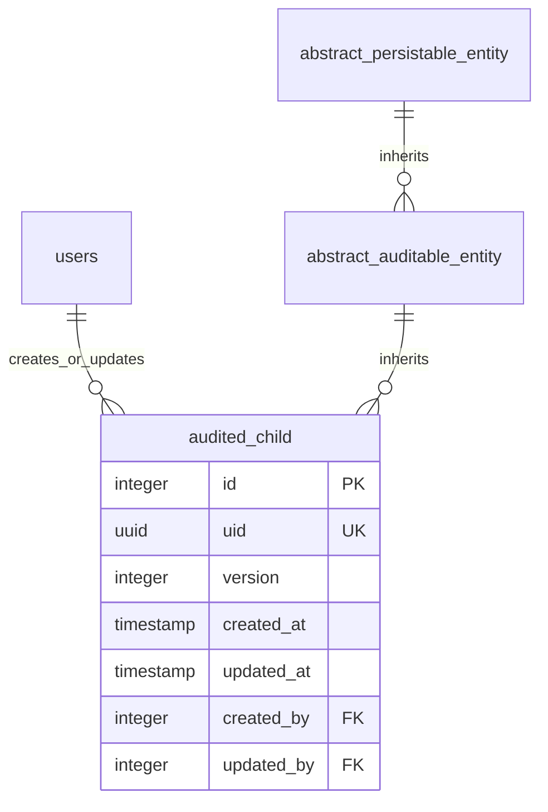
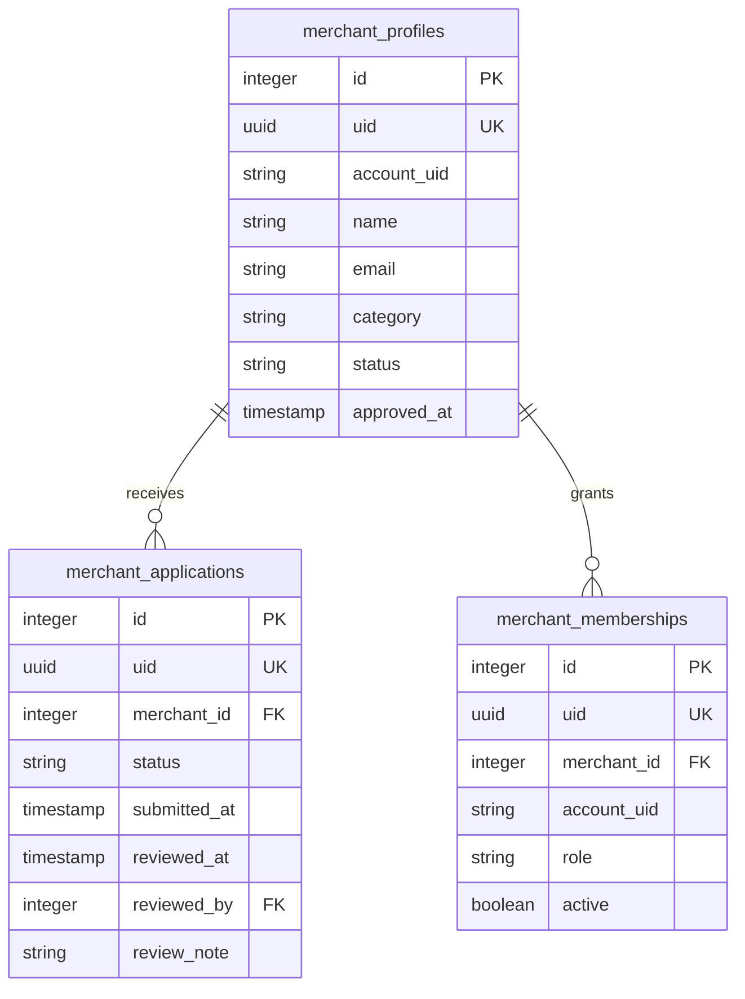
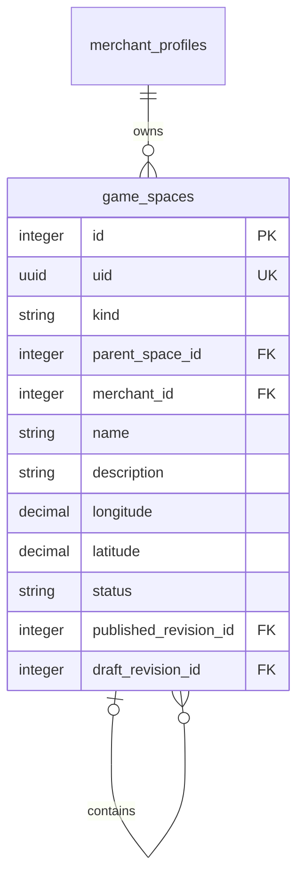
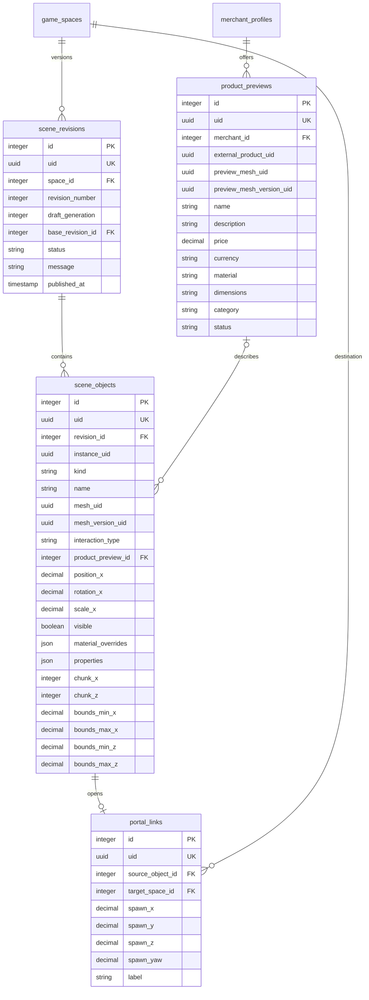
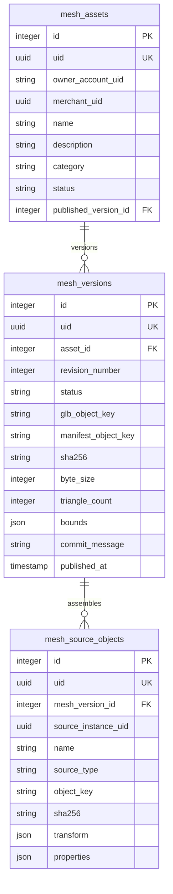
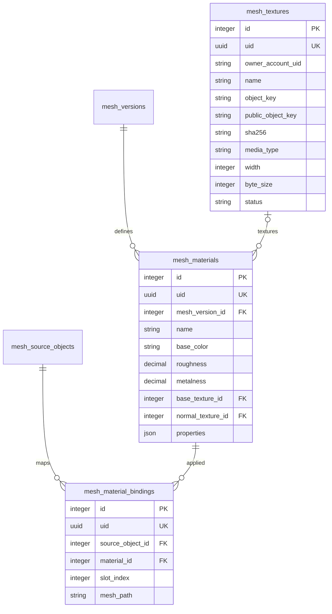
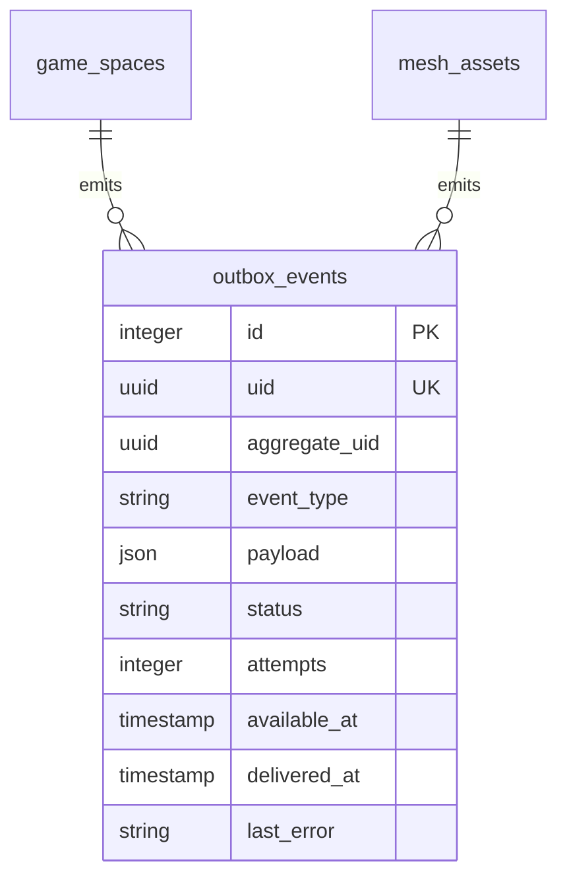
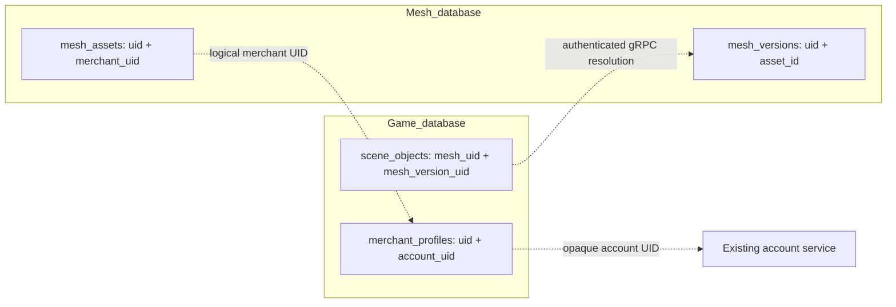
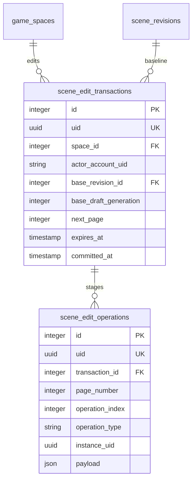

# ER diagrams, one responsibility at a time

Planning only; no database has been migrated. `game_db` and `mesh_db` are separate. Every proposed table below includes `id`, `uid`, `version`, `created_at`, `updated_at`, `created_by`, `updated_by` and **INHERITS (abstract_auditable_entity)**. Java entities extend the service-local `AbstractAuditableEntity`. See `DATABASE.md` for enum definitions, full constraints, sequencing and inherited foreign-key caveats.

## Step 0 — auditing shared by every new table

The abstract boxes show schema inheritance, not physical per-row parent joins. `audited_child` is a diagram placeholder for every new concrete table, not an actual proposed table. `users` is the existing service-local identity mirror; Firebase account IDs are in its `uid` string.

| Column | Type | Purpose |
|---|---|---|
| `id` | `integer primary key` | Local identity; match the inherited SERIAL/integer base. Redeclare child PK and sequence. |
| `uid` | `uuid not null unique` | Stable cross-service identifier for every new concrete table; gen_random_uuid(). |
| `version` | `integer` | Inherited JPA optimistic-lock column; not the business publication revision. |
| `created_at` | `timestamp` | Inherited creation timestamp, treated consistently as UTC. |
| `updated_at` | `timestamp` | Inherited last modification time. |
| `created_by` | `integer FK` | Inherited column; explicitly redeclare its FK to local users(id) on each child. |
| `updated_by` | `integer FK` | Inherited column; explicitly redeclare its FK to local users(id) on each child. |

## Step 1. People, roles and merchant approval — game_db

### `merchant_profiles`

A merchant identity and its public studio profile.

| Column | Type | Purpose |
|---|---|---|
| `account_uid` | `varchar(255)` | Authoritative Firebase/account UID; cross-service logical reference. |
| `name` | `varchar(120)` | Public merchant display name. |
| `email` | `varchar(255)` | Contact email; staff-only unless explicitly public. |
| `category` | `varchar(80)` | Merchant discovery category. |
| `status` | `merchant_status` | PENDING, APPROVED, SUSPENDED or REJECTED. |
| `approved_at` | `timestamp` | When an administrator approved the profile; nullable until approval. |

### `merchant_applications`

An auditable application and its review outcome.

| Column | Type | Purpose |
|---|---|---|
| `merchant_id` | `integer FK` | Local merchant_profiles.id. |
| `status` | `application_status` | PENDING, APPROVED or REJECTED. |
| `submitted_at` | `timestamp` | Submission instant. |
| `reviewed_at` | `timestamp` | Review completion instant; nullable. |
| `reviewed_by` | `integer FK` | Local users.id for the reviewer. |
| `review_note` | `text` | Staff explanation; never included in public DTOs. |

### `merchant_memberships`

A merchant-scoped business role, separate from global account roles.

| Column | Type | Purpose |
|---|---|---|
| `merchant_id` | `integer FK` | Local merchant_profiles.id. |
| `account_uid` | `varchar(255)` | Member identity resolved through account service. |
| `role` | `merchant_role` | OWNER or EDITOR within this merchant. |
| `active` | `boolean` | Whether this membership currently grants access. |

Global roles are verified by the existing account service. `merchant_memberships.role` is a native business-scope enum. An approval records a decision here and uses an outbox/account adapter to synchronize the global merchant role. Existing account role tables are not redesigned.

## Step 2. Maps, merchant spots and interior places — game_db

### `game_spaces`

One typed dimension: outer map, merchant spot, or interior room.

| Column | Type | Purpose |
|---|---|---|
| `kind` | `space_kind` | MAP, SPOT or PLACE; corresponds to browser maps/spots/places. |
| `parent_space_id` | `integer FK` | Self-reference. Null for maps; spot parent is map; place parent is spot/place. |
| `merchant_id` | `integer FK` | Owning merchant_profiles.id; nullable only for system-owned maps. |
| `name` | `varchar(120)` | Visible space title. |
| `description` | `text` | Introduction and editorial metadata. |
| `longitude` | `numeric(9,6)` | WGS84 longitude of map origin or spot anchor, -180..180. |
| `latitude` | `numeric(8,6)` | WGS84 latitude, -90..90. |
| `status` | `publication_status` | DRAFT, PUBLISHED or ARCHIVED. |
| `published_revision_id` | `integer FK` | Nullable pointer to a complete immutable scene revision. |
| `draft_revision_id` | `integer FK` | Nullable pointer to the current editable revision. |

Example: Design District (MAP) → Form & Field (SPOT) → Reading Room (PLACE) → Archive Room (PLACE). The public scene routes are plural aliases for `kind`; no polymorphic cross-table ID is required. Reject parent cycles.

## Step 3. Scene revisions and independent mesh instances — game_db

### `scene_revisions`

An atomic draft/published snapshot of one space.

| Column | Type | Purpose |
|---|---|---|
| `space_id` | `integer FK` | Owning game_spaces.id. |
| `revision_number` | `integer` | Business publication sequence, unique per space. |
| `draft_generation` | `integer` | Optimistic generation incremented on each draft save; API draftRevision. |
| `base_revision_id` | `integer FK` | Published revision from which edits began; supports stale-write checks. |
| `status` | `publication_status` | DRAFT or PUBLISHED; published revisions are immutable. |
| `message` | `text` | Optional commit note. |
| `published_at` | `timestamp` | Publication time; null for draft. |

### `scene_objects`

Independent placement of geometry or scene infrastructure within one revision.

| Column | Type | Purpose |
|---|---|---|
| `revision_id` | `integer FK` | Owning scene_revisions.id. |
| `instance_uid` | `uuid` | Stable identity of the object across revisions; unique within a revision. |
| `kind` | `scene_object_kind` | MESH, PRIMITIVE, LIGHT, GROUND or BARRIER; independent of behavior. |
| `name` | `varchar(120)` | Hierarchy label. |
| `mesh_uid` | `uuid` | Logical mesh-service asset UID; nullable for primitives/infrastructure. |
| `mesh_version_uid` | `uuid` | Exact committed mesh version pinned for reproducible publication. |
| `interaction_type` | `scene_interaction_type` | NONE, PRODUCT or TELEPORT; belongs to this placed instance only. |
| `product_preview_id` | `integer FK` | Required only for PRODUCT; null otherwise. |
| `position_x / y / z` | `double precision` | Local translation in metres, finite. |
| `rotation_x / y / z` | `double precision` | Euler XYZ rotation in radians, finite. |
| `scale_x / y / z` | `double precision` | Positive finite scale, defaults 1. |
| `visible` | `boolean` | Whether the instance is rendered. |
| `material_overrides` | `jsonb` | Validated per-instance material parameters/texture-version UIDs. |
| `properties` | `jsonb` | Typed kind-specific payload: primitive type/color, light intensity, collider dimensions, geo anchor. |
| `chunk_x / chunk_z` | `integer` | Anchor cell floor(local position / 24), for every space kind. |
| `bounds_min_x / max_x / min_z / max_z` | `double precision` | Transformed bounds used for overlap queries so large meshes are not clipped at cell edges. |

### `portal_links`

A TELEPORT interaction from any placed instance to a target space. Geometry does not determine behavior.

| Column | Type | Purpose |
|---|---|---|
| `source_object_id` | `integer FK` | Unique scene_objects.id whose interaction_type is TELEPORT. |
| `target_space_id` | `integer FK` | Destination game_spaces.id. |
| `spawn_x / y / z` | `double precision` | Required destination foot position in local metres; finite. |
| `spawn_yaw` | `double precision` | Arrival facing in radians; preserve the visitor’s selected camera mode. |
| `label` | `varchar(120)` | Visible destination label. |

### `product_previews`

Read-only product descriptions/prices used by clickable meshes in this stage.

| Column | Type | Purpose |
|---|---|---|
| `merchant_id` | `integer FK` | Product owner; must match scene ownership unless explicitly shared. |
| `external_product_uid` | `uuid` | Nullable future commerce-service identity; not an SQL FK. |
| `preview_mesh_uid / preview_mesh_version_uid` | `uuid` | Optional pinned mesh-service reference for the product’s hover/detail preview; no cross-database FK. |
| `name` | `varchar(160)` | Display name. |
| `description` | `text` | Public product story. |
| `price` | `numeric(14,2)` | Display price, nonnegative; never floating-point money in storage. |
| `currency` | `char(3)` | ISO currency code. |
| `material` | `varchar(255)` | Material description. |
| `dimensions` | `varchar(255)` | Human-readable dimensions. |
| `category` | `varchar(80)` | Catalog grouping. |
| `status` | `product_preview_status` | ACTIVE or HIDDEN. |

Two chairs share the same mesh UID/version UID but have different `instance_uid` values and transforms. A revision copies the logical instances into a new immutable snapshot. `published_revision_id` on game_spaces selects exactly one snapshot; it does not delete the older revision.

## Step 4. Reusable mesh assets and immutable binary versions — mesh_db

### `mesh_assets`

Stable identity of reusable geometry; never owns placed transforms, products or teleport interactions.

| Column | Type | Purpose |
|---|---|---|
| `owner_account_uid` | `varchar(255)` | Account-service owner identity. |
| `merchant_uid` | `uuid` | Optional logical game-service merchant UID, not an SQL FK. |
| `name` | `varchar(120)` | Library display name. |
| `description` | `text` | Asset description. |
| `category` | `mesh_category` | FURNITURE, LIGHTING, ARCHITECTURE, DECORATION, OTHER. |
| `status` | `publication_status` | DRAFT, PUBLISHED or ARCHIVED. |
| `published_version_id` | `integer FK` | Local pointer to the currently released mesh_versions row. |

### `mesh_versions`

A committed export with immutable content-addressable metadata.

| Column | Type | Purpose |
|---|---|---|
| `asset_id` | `integer FK` | Owning mesh_assets.id. |
| `revision_number` | `integer` | Monotonic per-asset sequence. |
| `status` | `mesh_version_status` | STAGED, VALIDATED, PUBLISHED or FAILED. |
| `glb_object_key` | `text` | Relative storage key for compiled GLB; never an expiring URL. |
| `manifest_object_key` | `text` | Relative key for editable source/assembly manifest. |
| `sha256` | `char(64)` | Binary integrity digest. |
| `byte_size` | `bigint` | Export size in bytes. |
| `triangle_count` | `integer` | Performance/validation budget. |
| `bounds` | `jsonb` | Validated min/max XYZ bounds in metres. |
| `commit_message` | `text` | Optional human review note. |
| `published_at` | `timestamp` | Commit/publication instant. |

### `mesh_source_objects`

Named source objects and normalized assembly transforms for re-editing.

| Column | Type | Purpose |
|---|---|---|
| `mesh_version_id` | `integer FK` | Owning version. |
| `source_instance_uid` | `uuid` | Stable object identity inside the asset. |
| `name` | `varchar(120)` | Source object label. |
| `source_type` | `mesh_source_type` | OBJ or PROCEDURAL. |
| `object_key` | `text` | Private OBJ key; null for procedural geometry. |
| `sha256` | `char(64)` | Source integrity hash, optional for procedural objects. |
| `transform` | `jsonb` | Validated position/rotation/scale plus source normalization matrix. |
| `properties` | `jsonb` | Procedural shape or import metadata, original filename, UV generation mode. |

## Step 5. Textures and material bindings — mesh_db

### `mesh_textures`

A reusable raster texture resource with immutable content key.

| Column | Type | Purpose |
|---|---|---|
| `owner_account_uid` | `varchar(255)` | Uploader identity resolved through account service. |
| `name` | `varchar(160)` | Human label / original filename. |
| `object_key` | `text` | Private original texture key. |
| `public_object_key` | `text` | Sanitized published derivative key, if released. |
| `sha256` | `char(64)` | Content digest; unique with owner or globally according to policy. |
| `media_type` | `varchar(80)` | Validated image/png, image/jpeg or image/webp. |
| `width / height` | `integer` | Decoded dimensions, bounded by configured limits. |
| `byte_size` | `bigint` | Stored bytes. |
| `status` | `publication_status` | DRAFT/PUBLISHED/ARCHIVED. |

### `mesh_materials`

Versioned material parameters for export.

| Column | Type | Purpose |
|---|---|---|
| `mesh_version_id` | `integer FK` | Owning immutable mesh version. |
| `name` | `varchar(120)` | Material slot name. |
| `base_color` | `varchar(9)` | Validated RGB/RGBA color. |
| `roughness` | `real` | Range 0..1. |
| `metalness` | `real` | Range 0..1. |
| `base_texture_id` | `integer FK` | Optional mesh_textures.id. |
| `normal_texture_id` | `integer FK` | Optional future normal-map reference. |
| `properties` | `jsonb` | Validated UV transform, emissive and transparency settings. |

### `mesh_material_bindings`

Maps a material to a particular source object / slot.

| Column | Type | Purpose |
|---|---|---|
| `source_object_id` | `integer FK` | mesh_source_objects.id, same mesh version as material. |
| `material_id` | `integer FK` | mesh_materials.id. |
| `slot_index` | `integer` | Zero-based mesh material slot. |
| `mesh_path` | `text` | Deterministic named node path for multi-mesh OBJ selection. |

## Step 6. Cross-service publication and delivery — each database separately

These two links are conceptual event-emission relationships. The databases have separate outbox tables; this diagram is not a cross-database foreign key.

### `outbox_events`

Transactional event delivery; each service owns its own table.

| Column | Type | Purpose |
|---|---|---|
| `aggregate_uid` | `uuid` | Space/mesh/merchant stable UID, never cross-database FK. |
| `event_type` | `domain_event_type` | SCENE_PUBLISHED, MESH_PUBLISHED, MERCHANT_APPROVED or ASSET_RETIRED. |
| `payload` | `jsonb` | Versioned public event schema; no raw tokens/source file contents. |
| `status` | `outbox_status` | PENDING, SENT or FAILED. |
| `attempts` | `integer` | Retry count. |
| `available_at` | `timestamp` | Next eligible dispatch time. |
| `delivered_at` | `timestamp` | Successful publication time. |
| `last_error` | `text` | Sanitized retry diagnostic. |

## Step 7 — service boundaries

Dashed arrows are application contracts, never SQL foreign keys. Storage bytes live outside PostgreSQL; mesh versions store immutable object keys, digests and sizes. Auditing user FKs stay within each service database. Sessions remain in the already implemented security layer.

## Step 8. Paged scene edit transactions — game_db

Every table below also includes all inherited audit fields and explicitly redeclared PK/UUID/auditor constraints described in Step 1 and DATABASE.md.

`space_id` selects the edited dimension; `actor_account_uid` prevents cross-user transaction reuse. The baseline revision/generation rejects stale saves. `next_page` enforces sequence; `expires_at` bounds abandoned work; `committed_at` supports idempotency. Operation rows identify their transaction, page/order, UPSERT/DELETE kind and placed instance. `payload` contains validated upsert data, never a whole-world replacement. Page size is at most 20. All repository searches return `Page<T>` with `Pageable`, mapped by shared `PaginationMapper`.

An editor may load only nearby cells. Applying its operation rows changes exactly those instances and keeps all unloaded instances. A mesh source has no interaction; PRODUCT/TELEPORT is a property of `scene_objects`, with arrival coordinates in `portal_links`. Numeric browser IDs remain separate from UUID service identities. [WEBSOCKET.md](WEBSOCKET.md) explains 24m/5×5 chunk queries and immutable version downloads.
