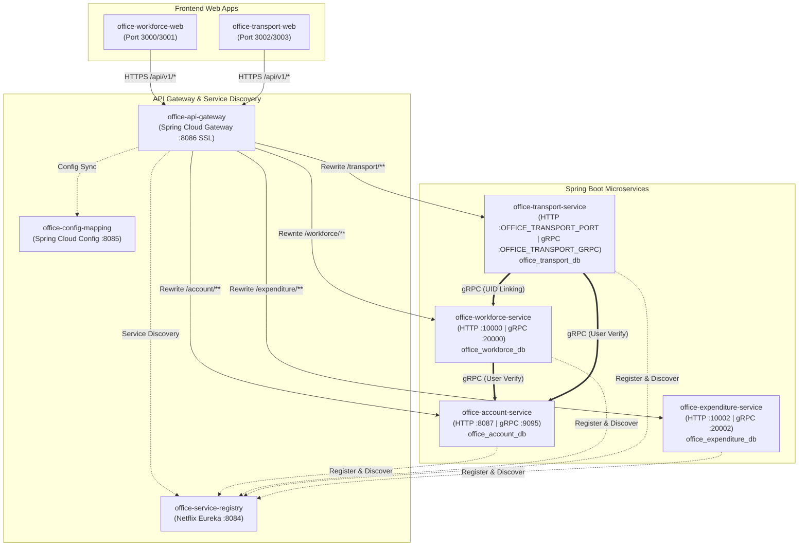
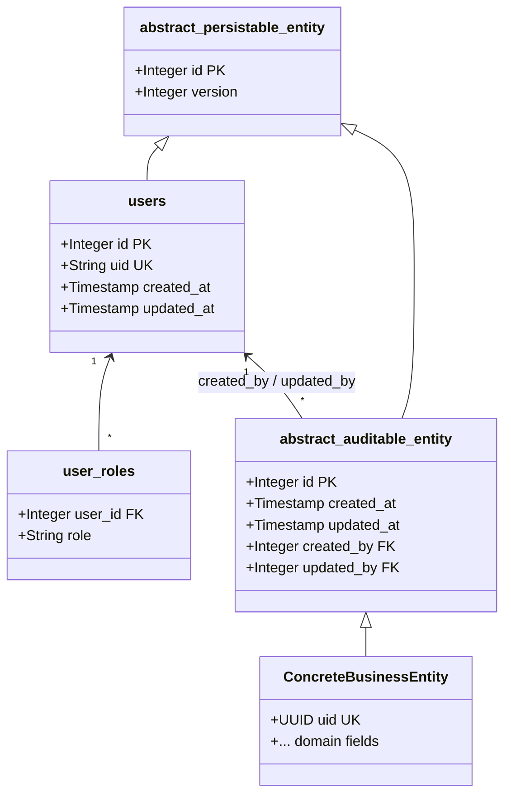

# Office Enterprise System — Architecture and Implementation Notes

## 1. System Overview & Scope

The **Office** project is a private, distributed enterprise management platform designed to manage company workforce data, administrative operations, and physical assets. It operates in parallel to the public-facing 3D Mesh Shop (`general`) within the same repository, sharing enterprise architecture principles while maintaining isolated business logic, data persistence, and security perimeters.

### Core Projects
1. **General**: Public 3D mesh shop and district exploration engine (`backend/general/*`, `frontend/general/*`).
2. **Office**: Private enterprise management suite for companies, workforce rosters, schedules, and vehicle fleets:
   - **Backend**: Spring Cloud microservices (`backend/office/*`, `backend/shared/office-starter`, `backend/shared/office-common-lib`).
   - **Frontend**: Two specialized Single Page Applications:
     - `office-workforce-web`: Administration portal for Companies, Departments, Staff, Schedules, and Persons.
     - `office-transport-web`: Administration portal for Person's Vehicles, Vehicle Registration Documents (VRD), OCR processing, and document management.

---

## 2. Microservice Topology & Infrastructure

The backend services are built with Java 17, Spring Boot 3, Spring Cloud 2023, Spring Security OAuth2 Resource Server, PostgreSQL, Liquibase, and gRPC.



### Infrastructure Components
- **`office-service-registry`** (Eureka Server, default port `8084`):
  Coordinates service discovery, IP resolution, and health tracking across all office microservices.
- **`office-config-mapping`** (Spring Cloud Config, default port `8085`):
  Centralized profile and YAML property repository for all office microservices.
- **`office-api-gateway`** (Spring Cloud Gateway, default port `8086`, SSL PKCS12 `keystore.p12`):
  - Base context path: `/api/v1`.
  - Route Rewrites:
    - `/api/v1/account/**` $\to$ `lb://OFFICE-ACCOUNT-SERVICE/**`
    - `/api/v1/workforce/**` $\to$ `lb://OFFICE-WORKFORCE-SERVICE/**`
    - `/api/v1/transport/**` $\to$ `lb://OFFICE-TRANSPORT-SERVICE/**`
    - `/api/v1/expenditure/**` $\to$ `lb://OFFICE-EXPENDITURE-SERVICE/**`
  - Internal Security Predicate: Blocks all calls matching `**/internal/**` from external internet ingestion.
  - Header & Cookie Filters: `DedupeResponseHeaderGatewayFilterFactory` for CORS headers, `CrossSiteCookieFilterFactory` for cross-site cookie propagation.

---

## 3. Database Architecture & Audit Strategy

Each microservice owns an independent PostgreSQL database. **No cross-database foreign keys are permitted.**

### Schema Inheritance Model (PostgreSQL `INHERITS`)
Every concrete business table inherits auditing metadata directly from `abstract_auditable_entity`:



1. **`abstract_persistable_entity`**:
   Provides `id SERIAL PRIMARY KEY` and `version INTEGER` for optimistic locking (`@Version`).
2. **Local `users` Mirror**:
   Every database maintains a localized mirror of `users` (synced via `UserSyncService` / `UserManagerService`) storing the global `uid` (string / UUID).
3. **`abstract_auditable_entity`**:
   `created_at`, `updated_at`, `created_by REFERENCES users(id) ON DELETE CASCADE` (or `SET NULL`), and `updated_by REFERENCES users(id)`.
4. **Child Tables Redeclaration Caveat**:
   Because PostgreSQL table inheritance does not automatically inherit constraints or primary keys, every child table explicitly redeclares:
   - `id SERIAL PRIMARY KEY`
   - `uid UUID UNIQUE DEFAULT gen_random_uuid()`
   - Foreign keys to local `users` for `created_by` and `updated_by`.

---

## 4. gRPC Inter-Service Communication & UID Linking

### The Problem
- `workforce-service` manages `persons` (with identity documents, contact numbers, and English/Chinese names).
- `transport-service` manages `vehicles` (plates, registration, VRD documents, avatars).
- Vehicles are owned by Persons. But `vehicles` lives in `office_transport_db` and `persons` lives in `office_workforce_db`.

### The Solution: UID (UUID) Linking via gRPC
1. **Logical Foreign Key**:
   The `vehicles` table in `transport-service` stores `person_uid UUID NOT NULL`. It never references a numeric `person_id`.
2. **Eureka-Aware gRPC Stub**:
   `backend/shared/office-starter` configures `GrpcStubConfig`:
   - Dynamically discovers downstream service IPs via `eurekaClient.getNextServerFromEureka(...)`.
   - Establishes persistent `ManagedChannel` instances with load balancing (round robin) and automatic retry policies on `UNAVAILABLE`.
3. **RPC Execution**:
   When `transport-service` needs Person metadata (e.g. for generating vehicle ownership badges, checking driver eligibility, or rendering person detail in `office-transport-web`):
   - Calls `OfficeWorkforceRPCServiceGrpc.getPersonByUid(OfficePersonRequest.newBuilder().setUid(personUid.toString()).build())`.
   - Receives `OfficePersonResponse` with nameEnglish, nameChinese, mobileTel, hkId, and active status.
4. **Fallback & Cache**:
   `transport-service` maintains an in-memory/Caffeine read-through cache for resolved person metadata, ensuring vehicle reads do not bottleneck on inter-service latency.

---

## 5. Security & Authentication Architecture

1. **Authentication Handshake (`office-account-service`)**:
   - `POST /api/v1/account/auth/login`: Validates credentials against `office_users`.
   - Returns `APIBaseResponseDTO<AuthTokenResponseDTO>`.
   - Sets a Partitioned, HttpOnly, Secure `_secure` cookie containing the JWT.
2. **Token Verification**:
   - Downstream services (`workforce-service`, `transport-service`) validate incoming JWTs via `JwtAuthenticationConverter` and public keys / JWKS from `account-service`.
   - Extract `uid` (`source.getSubject()`) and load the local `User` entity to populate Spring's `SecurityContextHolder`.
3. **Role-Based Access Control (RBAC)**:
   - Evaluated at controller layer using `@Secured`:
     - `@Secured({UserRoles.WORKFORCE_ADMIN, Roles.OFFICE_ADMIN})`
     - `@Secured({UserRoles.TRANSPORT_ADMIN, Roles.OFFICE_ADMIN})`
4. **CSRF Protection**:
   - `CookieCsrfTokenRepository.withHttpOnlyFalse()` with custom `SpaCsrfTokenRequestHandler` and `CsrfCookieFilter`.
   - The frontend reads `XSRF-TOKEN` cookie and supplies it in `X-XSRF-TOKEN` header for all mutating REST calls (`POST`, `PUT`, `DELETE`).

---

## 6. Frontend Architecture & Design Pattern

Both frontend applications (`office-workforce-web` and `office-transport-web`) adhere to the unified architecture:

```
frontend/office/web/<app>/
  ├── src/
  │   ├── api/
  │   │   ├── index.ts               # Core fetch wrapper, CSRF & credentials handling
  │   │   └── office.api.ts          # Base office API unboxer for APIBaseResponseDTO<T>
  │   ├── config/
  │   │   └── env.config.ts          # VITE_OFFICE_BASE_URL, port & security flags
  │   ├── contexts/
  │   │   └── OfficeAuthContext.tsx  # User state, login/logout, roles guard
  │   ├── models/
  │   │   ├── dto/
  │   │   │   ├── base/base.dto.ts   # APIBaseResponseDTO, PaginationBaseResponseDTO
  │   │   │   ├── request.dto.ts     # Request DTOs matching backend
  │   │   │   └── response.dto.ts    # Response DTOs matching backend
  │   │   └── errors/api.error.ts    # APIRequestError handling
  │   ├── services/
  │   │   └── content/               # Singleton Content Services (getInstance())
  │   │       ├── PersonContentService.ts
  │   │       ├── CompanyContentService.ts
  │   │       └── VehicleContentService.ts
  │   ├── components/                # Reusable UI (DataTable, Modals, AppShell)
  │   └── pages/                     # Routed views
```

### Principles
- **Singleton Services**: All HTTP communication is encapsulated in Singleton classes (`VehicleContentService.getInstance()`).
- **Response Unboxing**: `officeAPI<P, R>` validates `response.success === true` and unwraps `response.data`. Any error throws a strongly-typed `APIRequestError(response.message)`.
- **Zero Mock Fallback**: Production and staging connect strictly to `office-api-gateway` on port `8086`. No local mock storage in production builds.
