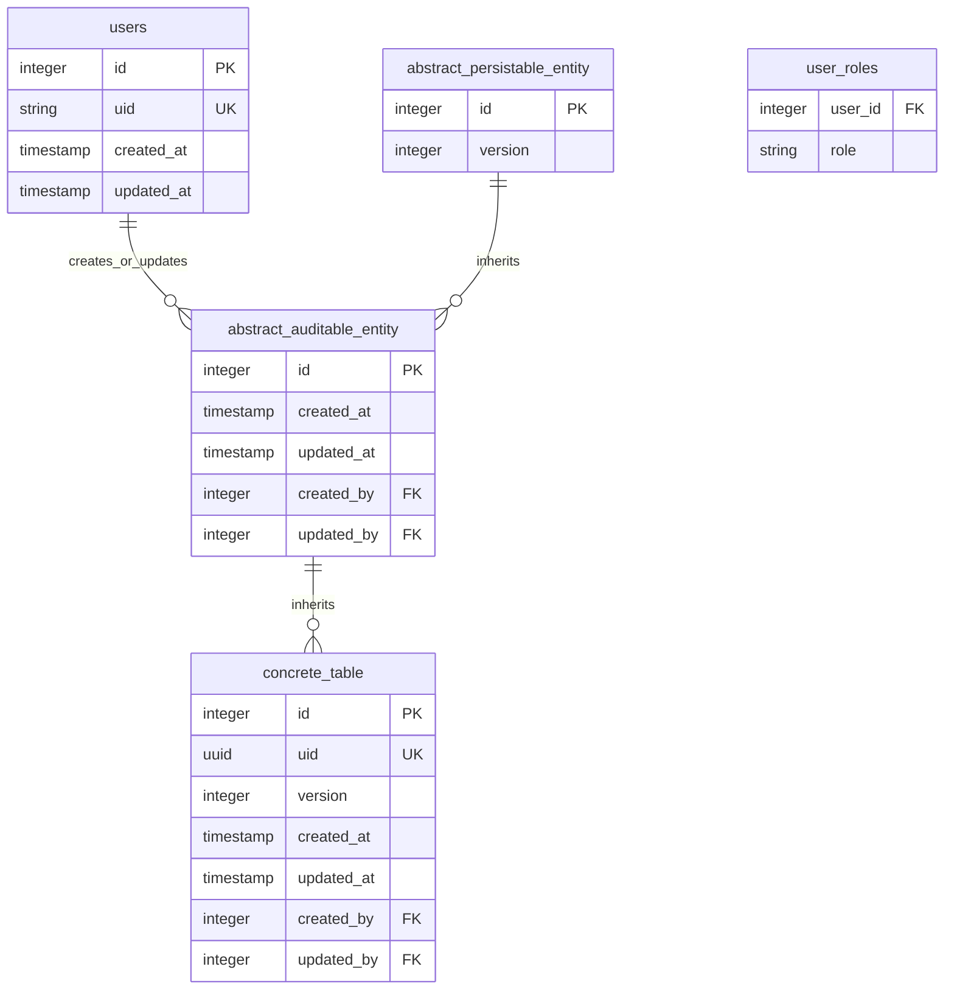
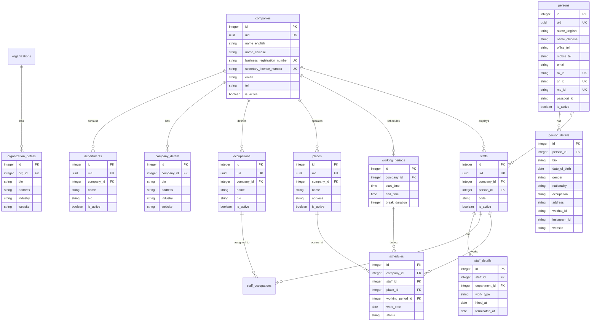
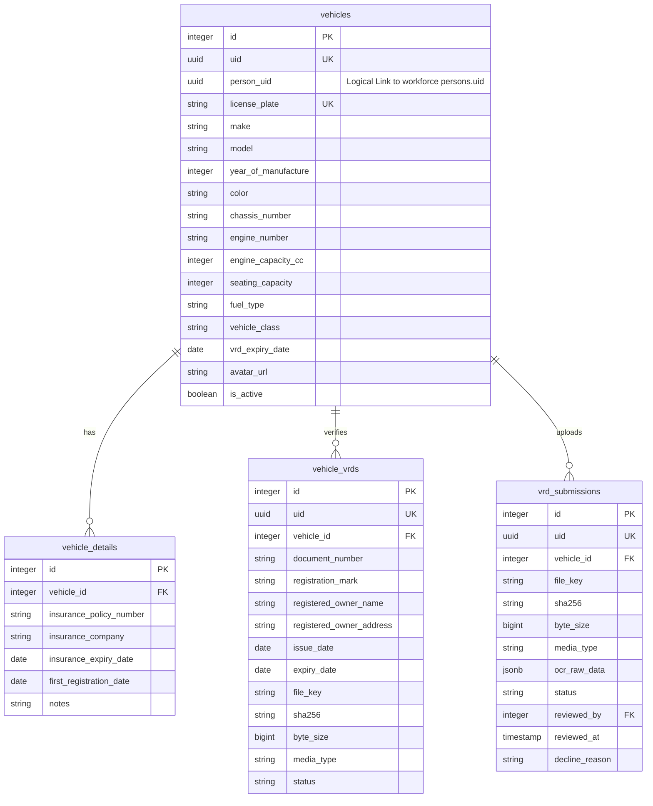
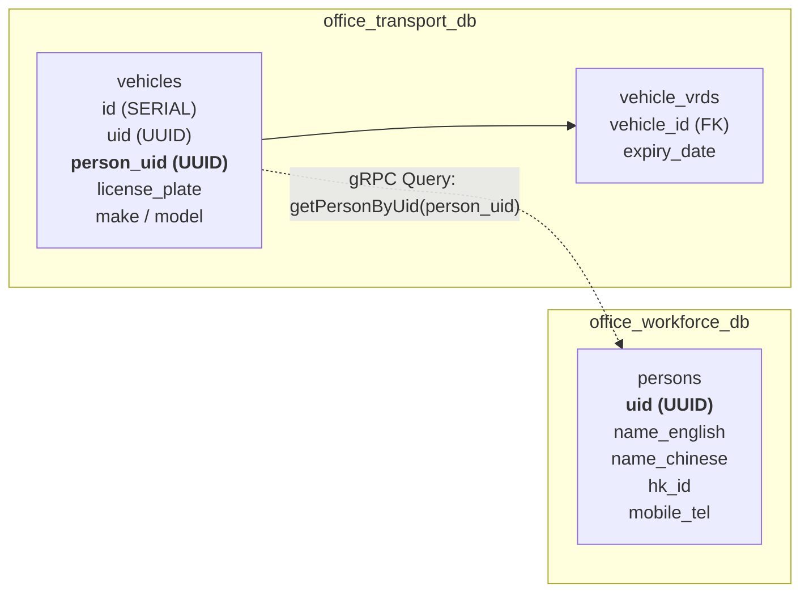

# Office Enterprise System — Entity Relationship Diagrams

## 1. Auditing Foundation Inheritance Model

Every concrete entity across all office databases inherits auditing columns from `abstract_auditable_entity`:

---

## 2. Workforce Service Schema (`office_workforce_db`)

---

## 3. Transport Service Schema (`office_transport_db`)

> **Note on Document Explorer**:
> Vehicle attachments and folder explorer files are **not stored in `office_transport_db`**. They are managed as a **pure file system** at `/data/local/office/transport-service/vehicles/{vehicleUid}/explorer`. If files disappear or are renamed on disk, exceptions are ignored gracefully and marked with warning signals.

---

## 4. Cross-Service Boundaries & gRPC Linking

- **Zero Cross-DB Foreign Keys**: Database engines are decoupled.
- **Resilient gRPC Lookup**: `transport-service` resolves owner data over authenticated gRPC with cached lookups.
