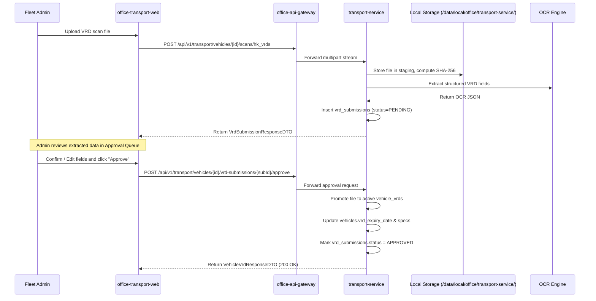

# Office Enterprise System — VRD Storage & OCR Pipeline

## 1. Overview & Business Context

In Hong Kong and international fleet management, every motor vehicle must maintain a valid **Vehicle Registration Document (VRD)** issued by the Transport Department. The document verifies legal ownership, chassis/VIN integrity, roadworthiness, and registration license expiry.

`transport-service` and `office-transport-web` provide a complete automated pipeline:
1. **Document Upload**: Scanned image/PDF uploaded through web UI.
2. **Object Storage**: Stored immutably with SHA-256 verification.
3. **Automated OCR**: Extracts vehicle specifications and owner data.
4. **Approval Queue**: Administrative verification and field correction.
5. **Active VRD Promotion**: Updates vehicle specifications and license expiry dates.
6. **Expiry Monitoring**: Alerts administrators when licenses approach expiration.

---

## 2. Storage Architecture & Pure File System Explorer

Storage across all vehicle assets (VRDs, vehicle avatars, staging uploads, and explorer documents) is hosted entirely on the **Local File System** (MinIO is removed):

```
Root Directory: /data/local/office/transport-service/
  ├── vehicles/
  │   └── {vehicleUid}/
  │       ├── avatar/
  │       │   └── avatar_{timestamp}.webp
  │       ├── vrds/
  │       │   └── {sha256}.pdf (or .jpg / .png)
  │       └── explorer/                    <-- PURE FILE SYSTEM (No DB records)
  │           ├── General/
  │           │   └── invoice_2026.pdf
  │           ├── Maintenance/
  │           │   ├── inspection_report.pdf
  │           │   └── battery_receipt.png
  │           └── Photos/
  │               └── exterior_front.jpg
  └── staging/
      └── {uploadUid}/
          └── scan_raw.{ext}
```

### 2.1 Pure File System Vehicle Explorer
- **Zero Database Persistence**: Files and folders created inside `/data/local/office/transport-service/vehicles/{vehicleUid}/explorer` are **not recorded in any database table**.
- **Direct Filesystem Operations**: Directory hierarchy, nested folders, file additions, renames, and deletions operate directly on the disk using standard Java NIO (`java.nio.file.Files`, `java.nio.file.Path`).
- **No Sync Desynchronization**: Prevents database-to-disk drift, orphan database IDs, or complex synchronization logic when operators or scripts modify files on the operating system.

### 2.2 Exception Handling & Warning Signals for Missing/Renamed Files
In production and local environments, files or directories can be renamed, relocated, or removed externally by system operators or maintenance jobs.

To guarantee zero crashes and seamless UI recovery:
1. **Graceful Exception Swallowing (Ignore Fatal Errors)**:
   - When attempting to read, stream, list, or stat files in `vrds`, `avatar`, `staging`, or `explorer`:
   - Catch `NoSuchFileException`, `FileNotFoundException`, and `AccessDeniedException`.
   - **Do not rethrow a 500 Internal Server Error** and do not fail the parent vehicle response.
2. **Warning Signal Emission**:
   - The API response decorates the file item with a **warning signal**:
     ```json
     {
       "fileName": "inspection_2025.pdf",
       "relativePath": "Maintenance/inspection_2025.pdf",
       "isAccessible": false,
       "warningSignal": "FILE_OR_FOLDER_INACCESSIBLE",
       "warningMessage": "Target file or folder has disappeared or was renamed on disk"
     }
     ```
   - In `office-transport-web`, an inaccessible item renders with a **warning icon/badge** (e.g., yellow alert triangle with tooltip `"File or folder no longer accessible on disk"`) instead of breaking the file explorer tree.

### 2.3 File Integrity Rules
- VRDs and staging scans are saved with their verified **SHA-256 hex digest** in the filename.
- Byte sizes and MIME types (`image/jpeg`, `image/png`, `application/pdf`, `image/webp`) are verified from the raw input stream, not trusted blindly from the client extension.
- Deleting an active VRD verifies that the file is safely unlinked without breaking other historical records.

---

## 3. OCR Pipeline & Field Mapping

Hong Kong Vehicle Registration Documents follow a standardized tabular format. The OCR extraction extracts the following schema:

```json
{
  "registrationMark": "AB 1234",
  "chassisNumber": "JT111JA0001234567",
  "engineNumber": "2GR-FE-9876543",
  "make": "TOYOTA",
  "model": "ALPHARD 350",
  "yearOfManufacture": 2022,
  "cylinderCapacity": 3456,
  "color": "WHITE",
  "registeredOwnerName": "CHAN TAI MAN",
  "registeredOwnerAddress": "FLAT A, 12/F, HAPPY BUILDING, HONG KONG",
  "firstRegistrationDate": "2022-03-15",
  "licenceExpiryDate": "2027-03-14"
}
```

---

## 4. Approval Queue Workflow



---

## 5. Expiry Tracking & Notification

The `vrd_expiry_date` column on `vehicles` drives status indicators and automated dashboards:

| Days Remaining | Status Flag | UI Visual Badge | Action |
|---|---|---|---|
| $> 60$ days | `VALID` | Green badge | Normal operation |
| $31 - 60$ days | `EXPIRING_SOON` | Yellow badge | Schedule inspection |
| $1 - 30$ days | `CRITICAL_EXPIRY` | Orange warning badge | Immediate renewal required |
| $\le 0$ days | `EXPIRED` | Red pulse badge | Vehicle de-rostered from schedule |
